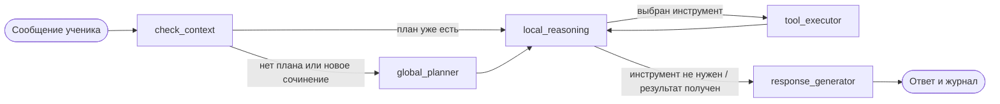

# ScrAIbe — ИИ-наставник для сочинения ЕГЭ (задание 27)

ScrAIbe разбирает сочинение по шагам. Диалог работает на LangGraph. В ходе разбора наставник может подобрать
литературный аргумент, найти сведения о произведении или запустить проверку текста. Выбор инструмента отображается
в журнале диалога.

Проект групповой. **Агентная часть** (граф, выбор инструментов, RAG, интерфейс) — [Арсений Новожилов](https://github.com/snthnk).
**NLP-модуль** (`nlp_module/`: орфография, пунктуация, грамматика, структура, баллы по критериям К1–К10) — [Никита Коротаев](https://github.com/rajecc).

## Как это работает



1. `check_context` сверяет версию сочинения, исходного текста и темы. При изменении обновляет контекст и сбрасывает кэш NLP-анализа.
2. `global_planner` строит план разбора по результатам NLP-анализа. Промпт запрашивает от трёх до шести шагов.
3. `local_reasoning` выбирает действие по последней реплике, истории и текущему шагу. За ход выполняется до одного инструмента.
4. `tool_executor` выполняет вызов и возвращает результат в `local_reasoning`, где код форматирует данные для ученика.
5. `response_generator` передаёт ответ ученику. После содержательной реплики модель может подтвердить выполнение текущего шага
   по ответу или правке сочинения. При переходе наставник добавляет вопрос по следующему шагу.

Граф хранит историю диалога, план, результаты NLP-анализа, журнал `reasoning_log` и решения селектора `tool_decisions`.

## Инструменты

| Инструмент | Что делает |
|---|---|
| `literature_rag` | Подбирает литературные аргументы по эмбеддингам и тегам |
| `web_fact_checker` | Возвращает ссылки и фрагменты выдачи Tavily по фактическому запросу |
| `expert_reasoning_tool` | Даёт комментарий по одному критерию К1–К10 |
| `nlp_analyzer` | Возвращает структуру, смысловые части, баллы и список ошибок |
| `nlp_structure_tool`, `nlp_semantics_tool`, `nlp_orthography_tool`, `nlp_punctuation_tool`, `nlp_grammar_tool`, `nlp_scoring_tool`, `nlp_errors_tool` | Запрашивают отдельные разделы NLP-анализа. Граф использует сохранённый раздел, если он есть |

### Как выбирается инструмент

В режиме `TOOL_SELECTION_MODE=llm` модель выбирает инструмент через function calling. При ошибке выбора граф пробует правила
из `agent_module/routing/rules.py`. Режим `TOOL_SELECTION_MODE=rules` сразу применяет правила к реплике ученика.

Сочинение, условие и исходный текст берутся из состояния графа. Решение селектора сохраняется в состоянии и журнале.

```
tool_decision {"tool": "literature_rag", "decided_by": "llm", "reason": "llm:function_call", "fallback_reason": null, "latency_ms": 812.4, "args": ["query"], ...}
```

`decided_by` указывает, кто выбрал действие. При переключении с модели на правила `fallback_reason` содержит причину.

## RAG по литературным аргументам

В [базе](data/arguments.csv) 164 карточки с автором, названием произведения, пересказом, тегами и ссылкой на источник.
`source` хранит пометку о сборе карточки, `source_url` — ссылку, по которой сверяли её содержание.
Кэш индекса в `data/rag_index/` привязан к хешу CSV и имени эмбеддера.

Запросы и карточки кодируются моделью `intfloat/multilingual-e5-large` с префиксами `query:` и `passage:`.
FAISS ищет ближайшие нормированные векторы через `IndexFlatIP`. Для локальных тестов доступен эмбеддер `hash`
на символьных n-граммах.

Гибридный режим сначала ищет 30 ближайших кандидатов, затем поднимает карточки с общими тегами.
Теги определяются по леммам запроса или передаются параметром инструмента. Оставшиеся места заполняются по векторной близости.

## Оценка

### Поиск литературных аргументов

В [наборе RAG](data/rag_eval.csv) 78 вопросов с ID карточек, которыми можно обосновать ответ.
Разметку сверяли по содержанию карточек и выдаче обоих режимов. Оба прогона использовали одну базу и один эмбеддер.
`Hit Rate@k` — доля вопросов, для которых среди первых `k` результатов есть карточка из разметки.

| Поиск с `intfloat/multilingual-e5-large` | Hit Rate@1 | Hit Rate@3 |
|---|---:|---:|
| Векторный | 47,4% (37/78) | 66,7% (52/78) |
| Гибридный | 61,5% (48/78) | 79,5% (62/78) |

```bash
python scripts/eval_rag.py --model intfloat/multilingual-e5-large
```

### Выбор инструмента

В [отложенном наборе](data/tool_selection_holdout.csv) 55 сценариев. Оба промпта получают одинаковые описания
инструментов, шаг плана и историю. `full` содержит правила выбора, `minimal` — роль наставника и короткую инструкцию
о вызове инструмента. Скрипт сравнивает первый запрос инструмента или решение `none` с меткой сценария.
Ложный вызов — запрос инструмента при метке `none`. Точность считается по всем 55 сценариям.
Во время прогона выбор делает одна модель. Переход на правила покрыт [тестами селектора](tests/test_selector.py).

| Промпт | Точность | Нужен инструмент | Ожидается `none` | Ложные вызовы | Ошибки API | Обрывы без вызова |
|---|---:|---:|---:|---:|---:|---:|
| Короткий (`minimal`) | 58,2% (32/55) | 19/40 | 13/15 | 2 | 0 | 1 |
| Рабочий (`full`) | 72,7% (40/55) | 33/40 | 7/15 | 8 | 0 | 0 |

Каждый промпт прогнали один раз на локальной [Qwen3-8B](https://huggingface.co/Qwen/Qwen3-8B)
с температурой 0, отключённым режимом размышления и лимитом 512 выходных токенов.
Для повтора используется MLX LM 0.32.2. Каталог `./qwen3-8b-4bit` содержит модель ревизии
`b968826d9c46dd6066d109eabc6255188de91218`, подготовленную через `mlx_lm.convert -q --q-bits 4 --q-group-size 64`.

```bash
mlx_lm.server --model ./qwen3-8b-4bit --host 127.0.0.1 --port 8765 \
  --temp 0 --max-tokens 512 --chat-template-args '{"enable_thinking":false}'
```

Во втором терминале запустите скрипт из корня проекта.

```bash
export LLM_PROVIDER=vsellm VSELLM_BASE_URL=http://127.0.0.1:8765/v1
export VSELLM_API_KEY=local-mlx LLM_TEMPERATURE=0
for prompt in full minimal; do
  python scripts/eval_tool_selection.py --methods llm --model default_model --prompt "$prompt" \
    --scenarios data/tool_selection_holdout.csv --out-dir "results/routing/$prompt"
done
```

## Запуск

```bash
python -m venv .venv && source .venv/bin/activate      # на Windows: .venv\Scripts\activate
pip install -r requirements.txt
cp .env.example .env                                    # впишите провайдера, ключ и модель

streamlit run app.py        # веб-интерфейс
python main.py              # консольный диалог
```

### Настройка `.env`

| Переменная | Назначение |
|---|---|
| `LLM_PROVIDER` | `vsellm`, `mistral` или `gemini` |
| `VSELLM_API_KEY`, `VSELLM_BASE_URL`, `VSELLM_MODEL_NAME` | ключ, адрес OpenAI-совместимого шлюза и модель; `VSELLM_EXPERT_MODEL_NAME` — отдельная модель для эксперта |
| `MISTRAL_API_KEY`, `GOOGLE_API_KEY` | ключи для Mistral и Gemini |
| `TAVILY_API_KEY` | поиск для `web_fact_checker` |
| `TOOL_SELECTION_MODE` | `llm` (по умолчанию) или `rules` |
| `RAG_EMBEDDER` | `e5` (по умолчанию) или `hash` |
| `LLM_FALLBACKS=0` | отключить запасные модели |

Список моделей VseLLM выводит `python scripts/list_models.py`.

### Тесты

```bash
pip install -r requirements-dev.txt
pytest          # сеть и ключи не нужны
ruff check .
```

## Структура

```
agent_module/
  graph/        узлы и сборка графа LangGraph (nodes.py, workflow.py, formatting.py — вывод результатов инструментов)
  routing/      выбор инструмента: LLM + правила, подстановка аргументов
  rag/          база аргументов, эмбеддеры, FAISS-индекс, гибридный поиск
  tools/        инструменты LangChain (RAG, веб-проверка, эксперт, обёртки над NLP)
  runner.py     запуск графа с повторами и сменой модели
  llms.py       фабрика LLM
nlp_module/     NLP-анализ сочинения (автор — Н. Коротаев)
data/           база аргументов и наборы для проверки RAG и выбора инструмента
scripts/        вспомогательные скрипты: проверка RAG и выбора инструмента, список моделей
tests/          тесты узлов, выбора инструмента, RAG и графа целиком (с подставной LLM)
app.py          интерфейс Streamlit
main.py         консольный интерфейс
```
